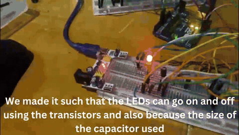

# Instrumentation & Circuits Projects

Two electronics projects built with Arduino Uno by Shadrack Agyei Nti and Sean Yeboah.

## 1. Intruder Alarm System Using an Astable Multivibrator

*Circuits and Electronics, August 2024*

  

An object-detection alarm that combines an analog oscillator with Arduino control. An IR sensor detects an object, then the Arduino powers an astable multivibrator (LEDs flash alternately) and sounds a buzzer until the object leaves.

**How it works**

- **Astable multivibrator:** two 2N3904 NPN transistors cross-coupled through capacitors C1/C2 and resistors R2/R3. Each capacitor charges until it switches the opposite transistor on, so the circuit oscillates continuously and the two LEDs blink in turn. R1/R4 set the LED current.
- **IR sensor:** 5 V module with its output on Arduino pin A0.
- **Arduino Uno:** reads the IR sensor, supplies power to the multivibrator and drives the buzzer only when something is detected.

**Limitations:** short IR range (worse in bright light), a buzzer-only alert, no remote notifications, and no way to tell objects apart.

- 📄 [Project report](Circuits%20Final%20Project%20Report.pdf)
- 🎥 [Demo video](circuits%20video.mp4)

## 2. Temperature Data Acquisition System

*ENGR212: Instrumentation for Engineering, December 2024*

A temperature measurement system covering 25–35 °C with 0.01 °C resolution.

**Signal chain:** NTC thermistor → Wheatstone bridge → difference amplifier (gain ≈ 10) → active low-pass filter (fc = 20 Hz) → Arduino Uno ADC → 16×2 I²C LCD

- **Sensing:** NTC thermistor in a Wheatstone bridge, balanced at 25 °C with a 10 kΩ potentiometer.
- **Conditioning:** a difference amplifier (1 kΩ / 10 kΩ) scales the bridge output to the ADC range (≈0.4 V at room temperature, ≈3.9 V at body temperature). An op-amp low-pass filter removes noise above 20 Hz.
- **Conversion:** the ADC reading indexes a lookup table generated from the Steinhart–Hart equation, using coefficients fitted to resistance measured at 25, 30 and 35 °C.

**Result:** readings across the full 25–35 °C range at 0.01 °C resolution, shown live on the LCD.

- 📄 [Project documentation](Instrumentation_Final_Project.pdf)
- 💻 [Arduino code](https://github.com/ShadrackAgyei/Temperature-Measurement-System)

## Tools

Arduino Uno · breadboard prototyping · 2N3904 transistors · IR sensor · NTC thermistor · op-amps · 16×2 I²C LCD
